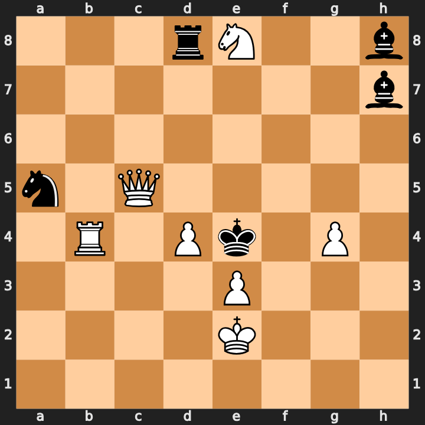

# Board views for a model: how should Claude "see" a position? (9 Oct 2026)

Session "Chess position visualization" (9 Oct 2026, 10:09-14:54 UTC, from E. Bourd's phone), run in the
**Personaldashboard** repository (folder `chesslab/`, branch `ccr-859f3d72-q4pgb7`, never merged), not here. Nothing
of it reached this repository until 6 Nov 2026, when it was rebuilt from that session's transcript:
- `tools/board_views.py`: the nine views, code unchanged (`python tools/board_views.py "<FEN>" [view ...]`); test
  `tests/test_board_views.py`.
- `board_views_2026-10-09/FINDINGS.md` and `BACKLOG.md`: the lab's own files, verbatim.
- The lab's other parts (`lab.py` with bench generator, blind-subject audit, mate-in-2 verifier, 17 self-tests, the
  standing "self-improving lab" instructions) stay in Personaldashboard.

## The question (E. Bourd, 9 Oct, typed on a phone)
"How do you actually feel lines, adjacency in a given board. Do you care if it's a fen or a board 8x8. Maybe there is
some better medium to understand the position relations ... if I look at some position, I see immediately some
relations like attacking capturing squares lines, I am probably running some mini pattern recognition and a search. But
on that grided view of pieces and not on a tool result." Then: "it's for understanding composing better ... the pure
fen cannot be great"; "Go try stuff and see if it improves your understanding and reasoning over positions."
At 11:04: "How can we make trivial understandings more natural, like what attacks what, this piece stands in the
diagonal." At 13:38: "compose a mate in 2 where a double check is a threat. Tell the agent to try and visualize the
board via those different terms." At 14:44: make the environment improve itself.

## Method
Blind subjects: subagents of the same model, one prompt file each, no tools, answers scored against python-chess
(F1 per probe). Probes: square lookup, slider rays, pins, hanging pieces, all checks, mate in 1; later x-ray lines,
discovered checks, profitable captures, mate in 2. "Glance" = answer at once; "deliberate" = think it through.
Small samples (12-16 positions): a difference of 1-2 items is noise.

## The views, on one position
E. Bourd, `bourd-selfpin-changed-mates-2` (#2, 7+5, 1.Qh5!): FEN `3rN2b/7b/8/n1Q5/1R1Pk1P1/4P3/4K3/8`.


The views use English letters (N = knight). Generated with `python tools/board_views.py "<FEN>"`.

**fen**: the FEN alone.
```
FEN: 3rN2b/7b/8/n1Q5/1R1Pk1P1/4P3/4K3/8 w - - 0 1
```
**grid**: an 8x8 text board. **grid_list**: the same plus a piece list:
```
8 | . . . r N . . b
7 | . . . . . . . b
6 | . . . . . . . .
5 | n . Q . . . . .
4 | . R . P k . P .
3 | . . . . P . . .
2 | . . . . K . . .
1 | . . . . . . . .
    ---------------
    a b c d e f g h
White: Ke2 Qc5 Rb4 Ne8 Pe3 Pd4 Pg4
Black: Ke4 Rd8 Bh7 Bh8 Na5
Side to move: White (uppercase=White, lowercase=Black)
```
**lines**: the grid and list, then every file, rank and diagonal holding two or more units, written out square by square,
so that pieces on one line stand next to each other in the text:
```
LINES (only lines holding 2+ pieces):
file d: d1=. d2=. d3=. d4=P d5=. d6=. d7=. d8=r
file e: e1=. e2=K e3=P e4=k e5=. e6=. e7=. e8=N
file h: h1=. h2=. h3=. h4=. h5=. h6=. h7=b h8=b
rank 4: a4=. b4=R c4=. d4=P e4=k f4=. g4=P h4=.
rank 5: a5=n b5=. c5=Q d5=. e5=. f5=. g5=. h5=.
rank 8: a8=. b8=. c8=. d8=r e8=N f8=. g8=. h8=b
diag↗ a5-d8: a5=n b6=. c7=. d8=r
diag↗ a3-f8: a3=. b4=R c5=Q d6=. e7=. f8=.
diag↗ a1-h8: a1=. b2=. c3=. d4=P e5=. f6=. g7=. h8=b
diag↗ b1-h7: b1=. c2=. d3=. e4=k f5=. g6=. h7=b
diag↗ d1-h5: d1=. e2=K f3=. g4=P h5=.
diag↘ a5-e1: a5=n b4=R c3=. d2=. e1=.
diag↘ a7-g1: a7=. b6=. c5=Q d4=P e3=P f2=. g1=.
```
**relations**: the grid and list, then what each unit attacks and who attacks and defends it (no names such as "pin"):
```
ATTACKS (squares each piece attacks; occupied ones marked):
wKe2 -> d1 e1 f1 d2 f2 d3 e3(P) f3
wPe3 -> d4(P) f4
wRb4 -> b1 b2 b3 a4 c4 d4(P) b5 b6 b7 b8
wPd4 -> c5(Q) e5
wPg4 -> f5 h5
wQc5 -> c1 c2 c3 b4(R) c4 d4(P) a5(n) b5 d5 e5 f5 g5 h5 b6 c6 d6 a7 c7 e7 c8 f8
wNe8 -> d6 f6 c7 g7
bKe4 -> d3 e3(P) f3 d4(P) f4 d5 e5 f5
bNa5 -> b3 c4 c6 b7
bBh7 -> e4(k) f5 g6 g8
bRd8 -> d4(P) d5 d6 d7 a8 b8 c8 e8(N)
bBh8 -> d4(P) e5 f6 g7

PIECE STATUS (attacked by enemy / defended by own):
wKe2: attacked by [] defended by []
wPe3: attacked by [bKe4] defended by [wKe2]
wRb4: attacked by [] defended by [wQc5]
wPd4: attacked by [bKe4, bRd8, bBh8] defended by [wPe3, wRb4, wQc5]
wPg4: attacked by [] defended by []
wQc5: attacked by [] defended by [wPd4]
wNe8: attacked by [bRd8] defended by []
bKe4: attacked by [] defended by [bBh7]
bNa5: attacked by [wQc5] defended by []
bBh7: attacked by [] defended by []
bRd8: attacked by [] defended by []
bBh8: attacked by [] defended by []
```
**annotated** (added at 14:45, after it was the best composing method): each unit with its lines of sight per
direction, the first blocker marked own/ENEMY and the x-ray behind it:
```
PIECES (lines of sight per direction; first blocker marked; x-ray = next piece behind it):
White:
  Ke2: → d1 e1 f1 d2 f2 d3 e3[P own] f3  {attacked by -; defended by -}
  Qc5: ↑ c6 c7 c8   ↓ c4 c3 c2 c1   → d5 e5 f5 g5 h5   ← b5 a5[n ENEMY]   ↗ d6 e7 f8   ↖ b6 a7   ↘ d4[P own] (x-ray→ e3[P own])   ↙ b4[R own]  {attacked by -; defended by Pd4}
  Rb4: ↑ b5 b6 b7 b8   ↓ b3 b2 b1   → c4 d4[P own] (x-ray→ e4[k ENEMY])   ← a4  {attacked by -; defended by Qc5}
  Ne8: → d6 f6 c7 g7  {attacked by Rd8; defended by -}
  Pe3: attacks d4[P own] f4  {attacked by Ke4; defended by Ke2}
  Pd4: attacks c5[Q own] e5  {attacked by Ke4,Rd8,Bh8; defended by Pe3,Rb4,Qc5}
  Pg4: attacks f5 h5  {attacked by -; defended by -}
Black:
  Ke4: → d3 e3[P ENEMY] f3 d4[P ENEMY] f4 d5 e5 f5  {attacked by -; defended by Bh7}
  Rd8: ↓ d7 d6 d5 d4[P ENEMY]   → e8[N ENEMY] (x-ray→ h8[b own])   ← c8 b8 a8  {attacked by -; defended by -}
  Bh7: ↖ g8   ↙ g6 f5 e4[k own]  {attacked by -; defended by -}
  Bh8: ↙ g7 f6 e5 d4[P ENEMY]  {attacked by -; defended by -}
  Na5: → b3 c4 c6 b7  {attacked by Qc5; defended by -}
```
**salient**: only named motifs (loose pieces, lines to king or queen: check line, pin, battery), both king fields, checks:
```
SALIENT RELATIONS:
  LOOSE: wNe8 attacked by bRd8, undefended
  LOOSE: bNa5 attacked by wQc5, undefended
  BATTERY (discovery possible): wRb4 → through wPd4 to bKe4
  OPEN FILES (no pawns): a b c f h

White king e2 zone:
  d1: empty; covered by []
  e1: empty; covered by []
  f1: empty; covered by []
  d2: empty; covered by []
  f2: empty; covered by []
  d3: empty; covered by [Ke4]
  e3: own P; covered by [Ke4]
  f3: empty; covered by [Ke4]
Black king e4 zone:
  d3: empty; covered by [Ke2]
  e3: enemy P; covered by [Ke2]
  f3: empty; covered by [Ke2]
  d4: enemy P; covered by [Pe3, Rb4, Qc5]
  f4: empty; covered by [Pe3]
  d5: empty; covered by [Qc5]
  e5: empty; covered by [Pd4, Qc5]
  f5: empty; covered by [Pg4, Qc5]
CHECKS for side to move: Nd6+, Nf6+, Qc2+, Qc6+, Qd5+, Qe5+, Qe7+, Qf5+, d5+
```
**kingzone**: relations, plus the defending king's field and every check (only the added part shown):
```
Black king e4 zone:
  d3: empty; covered by [Ke2]
  e3: enemy P; covered by [Ke2]
  f3: empty; covered by [Ke2]
  d4: enemy P; covered by [Pe3, Rb4, Qc5]
  f4: empty; covered by [Pe3]
  d5: empty; covered by [Qc5]
  e5: empty; covered by [Pd4, Qc5]
  f5: empty; covered by [Pg4, Qc5]
ALL CHECKS for side to move: Nd6+, Nf6+, Qc2+, Qc6+, Qd5+, Qe5+, Qe7+, Qf5+, d5+
```
**tree1**: kingzone, plus one ply of search: every White check and capture with all of Black's replies (added part):
```
1-PLY TREE (each checking or capturing move: opponent's legal replies):
  Nd6+: 1 replies: Rxd6
  Nf6+: 1 replies: Bxf6
  Qc2+: 1 replies: Kd5
  Qc6+: 2 replies: Nxc6 Rd5
  Qd5+: 2 replies: Kxd5 Rxd5
  Qe5+: 1 replies: Bxe5
  Qe7+: 2 replies: Be5 Kd5
  Qf5+: 1 replies: Bxf5
  Qxa5: 15 replies: Be5 Bf5 Bf6 Bg6 Bg7 Bg8 Bxd4 Ra8 Rb8 Rc8 Rd5 Rd6 Rd7 Rxd4 Rxe8
  d5+: 3 replies: Bd4 Ke5 Nc4
```
On this position only annotated and salient name the half-battery Rb4/d4 behind 1.d5+ (the would-be cook, refuted by
1...Sc4), and only tree1 shows that refutation. No static view shows the content: 1...Rxd4 is a self-pin that exists
only after the move. That is the lab's top backlog item, a view of what a move changes.

## Results
**Round 1** (16 random positions, 5 views, deliberate): mean F1 FEN 0.976, grid 0.988, grid_list 0.990, lines 0.979,
relations 0.993. All 11 misses were omissions (a check or a mate missed), never an invented relation. The prediction
"FEN hurts" was wrong: with room to think, a subject rebuilds the board from any format.

**Round 2** (12 positions with 22+ units, 6 with a mate in 2):

| perception mean | FEN | grid_list | lines | relations |
|---|---|---|---|---|
| glance | 0.95 | 0.97 | 0.97 | 1.00 |
| deliberate | 1.00 | 1.00 | (cut off) | 1.00 |

FEN glance misses were long range: an h-file capture, a long-diagonal x-ray, one invented x-ray. Mate in 2, deliberate:
FEN 1/6, grid_list 4/6, relations 2/6; glance 0/6 in every view. A safety classifier cut off 3 long deliberate runs.

**Round 3** (12 mate-in-2 positions, subjects told a mate exists): grid_list 11/12, relations 12/12, kingzone 11/12,
tree1 12/12. Being told raised the rate from about 2/6 to 12/12 (different positions; every key was a check). tree1 was
about 4 times faster (~50 s per batch against 90-245 s). The one error, twice: a pawn interposing on the check line
(1.Qf3+? e4!).

**Lab run** (geometry set, glance, 12 positions): mean F1 grid_list 0.842, relations 0.88, annotated 0.90, salient 0.90;
the new views scored 1.00 only on probes their own text gives away; discovered checks were absent from all 12
positions; mate in 2 was 0/6 everywhere. In two positions every subject listed the mating key as a good capture but
none saw it mate. They saw the move and missed its consequence.

## Composing: #2 with a double-check threat, one composer per view (n=1 each)

| method | first try | after one round of solver output |
|---|---|---|
| annotated | sound | |
| lines | sound (duals) | |
| free choice | sound (threat duals) | |
| grid | cooked by 1.Sxb8 | sound |
| relations | cooked by 1.Sd7+/1.Sg6+ | sound |

Both cooks were missed White forcing moves (a capture, knight checks), not misread geometry, and one round of exact
solver output fixed both. **A verifier in the loop mattered more than the view.** Weak hint: the methods that make the
composer write every line of sight (annotated, lines) were sound first try; the failed ones show only the relations the
composer chooses to look at.

Re-solved here on 6 Nov with `chesscomp.report --critique`:
- annotated `8/8/2B5/8/4N2n/4K3/7p/7k`: 1.Kf2! (2.Sg3#), unique, the threat a double check;
- free `7k/8/4K3/8/7N/8/8/7R`: 1.Kf7!, four threats;
- relations, repaired `5b1k/5P1p/7P/4NN2/8/8/8/2BK4`: 1.Bb2! (2.Sg6#, a double check).

All sound, and none a problem by our gate: single phase, flights in the diagram, a flight-taking key, an out-of-play
key (1.Bb2). The lab measured only "sound or cooked", far below this repository's standard.

## Conclusions (then, and how they read now)
1. **Format barely matters for seeing; search is the bottleneck.** "I don't see the board; I rebuild it." With thought,
   every view reached ~100% on static relations. The failures were omitted forcing moves and missed consequences.
   This repository reached the same rule from the other side: "the solver before any claim", and the `Claude sight`
   lessons (unseen long queen lines to check squares, the missed 1...Qd6 unpin).
2. **The framing beats the representation.** Being told a mate exists, or being handed every check with its replies
   (tree1), helped far more than any layout. Relations plus forcing moves plus replies was the best combination.
3. **For composing, a verifier in the loop is worth more than any view**; writing every line of sight helps a little.
4. **Next step proposed then, still open:** a *delta* view (what a move changes: lines opened or closed, new attacks,
   loose units, flights gained or lost). Our `chesscomp.anatomy` (11 Oct) covers part of it for mates (field changes,
   why a try fails); there is no general "after move X" view yet.

Open, never answered: a routine to keep the lab improving, a pull request for the branch, a larger composing
comparison (4-5 problems per view).
